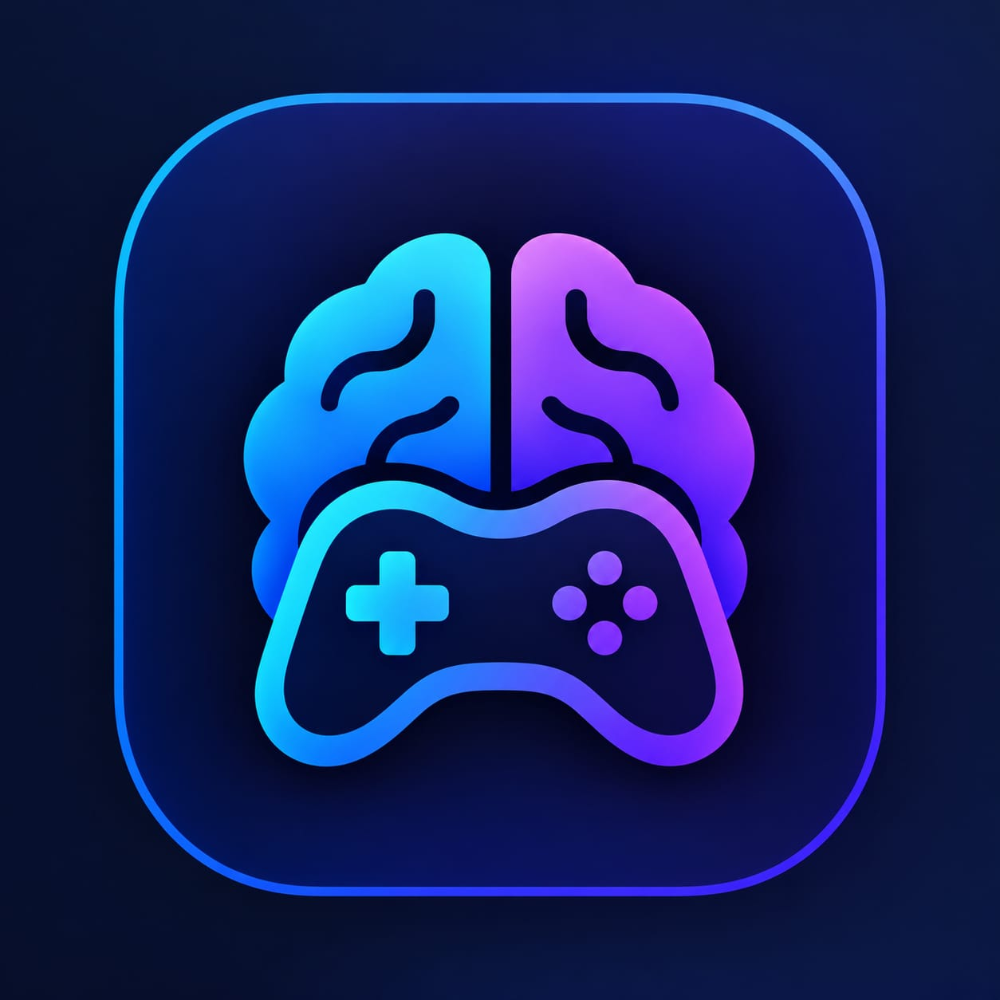

# Brain Booster 🧠

<div align="center">
  
  <h1>Brain Booster</h1>
  <p><em>A powerful brain training Flutter app for fast mental calculations with comprehensive dashboard tracking.</em></p>
</div>

A powerful brain training Flutter app for fast mental calculations with comprehensive dashboard tracking. Built with modern Flutter architecture using Provider for state management. Features a **completely redesigned UI/UX** with a unified design system, dark/light themes, and premium interactions.

---

## ✨ Features

### 🎮 Game Modes
- **Daily Challenge** - 10 mixed questions to start your day
- **Speed Run** - 20 questions, 15 seconds each for quick thinking
- **Practice Mode** - No time limit, learn at your own pace
- **Custom Game** - Configure your own operation, difficulty, and settings

### 🧮 Mathematical Operations
- Addition (+)
- Subtraction (−)
- Multiplication (×)
- Division (÷)
- Modulo (%)

### 📊 Difficulty Levels
- **Easy** - Single digit numbers (1-10), generous time
- **Medium** - Double digits (10-50), moderate time
- **Hard** - Triple digits (50-100), tight time limit
- **Expert** - Complex calculations (100-500), minimal time

### 📈 Dashboard & Analytics
- Real-time accuracy tracking
- Performance charts (14-day trend)
- Operation-wise breakdown
- Difficulty progression
- GitHub-style contribution calendar
- **Brain Power Score (0-100%)** with adaptive difficulty

### ⚙️ Customization
- **Dark/Light theme toggle** with system preference support
- Sound & vibration settings
- Default game preferences
- Questions per session (5-50)
- Time limit per question (0-60s)
- **Progressive difficulty mode** (adapts to your skill)

### 📜 History & Progress
- Complete game session history
- Detailed question-by-question review
- Export data functionality
- Streak tracking (current & best)

---

## 🎨 UI/UX Redesign Highlights

### 🎯 Design System (`lib/theme/design_tokens.dart`)
A comprehensive design token system ensuring visual consistency:
- **Colors** — Primary, semantic, surface, text, border tokens
- **Spacing** — XS to 4XL, page margins, component gaps
- **Radius** — SM to 2XL for consistent rounded corners
- **Elevation** — Subtle, card, elevated, colored shadows
- **Typography** — Headlines, titles, body, labels, numbers
- **Animations** — Fast/normal/slow durations, spring curves
- **Touch targets** — 48dp minimum for accessibility

### 🏠 Home Screen Redesign
| Before | After |
|--------|-------|
| Overlapping header text | Clean header with gradient title + Brain Power card |
| Truncated trend badges | Full text with `FittedBox`, `Flexible`, ellipsis handling |
| Cluttered progress cards | Responsive 2-col/4-col grid with subtitles |
| Basic operation cards | 88px cards with full names, semantic labels |
| Fixed difficulty buttons | Compact chips + full cards with descriptions |
| Content hidden by nav | Proper `kBottomNavigationBarHeight` padding |

### 🧩 Widget Overhaul
| Widget | Improvements |
|--------|--------------|
| **StatCard** | `FittedBox` values, `Flexible` trends, subtitles, accessibility semantics |
| **OperationCard** | 88px width, full operation names, semantic labels, `OperationChip` variant |
| **DifficultyCard** | Compact/full modes, selector row, descriptions, semantic labels |

---

## 🏗️ Architecture

```
lib/
├── main.dart                 # App entry point
├── models/                   # Data models
│   ├── math_question.dart    # Question generation & validation (progressive difficulty)
│   ├── user_stats.dart       # User statistics & brain strength
│   ├── app_settings.dart     # App preferences
│   └── game_session.dart     # Game session & results
├── providers/                # State management (Provider)
│   ├── app_provider.dart     # AppProvider (settings, stats, storage)
│   └── game_provider.dart    # GameProvider (game state, adaptive difficulty)
├── screens/                  # UI screens
│   ├── home_screen.dart      # 🎨 Redesigned main dashboard
│   ├── game_screen.dart      # Active gameplay
│   ├── dashboard_screen.dart # Analytics & charts
│   ├── settings_screen.dart  # App preferences
│   └── history_screen.dart   # Game history
├── services/                 # Persistence layer
│   ├── storage_service.dart  # SharedPreferences wrapper
│   └── feedback_service.dart # Haptic & sound feedback
├── theme/                    # Theming & design system
│   ├── app_theme.dart        # Light/Dark themes
│   └── design_tokens.dart    # 🎨 NEW: Unified design tokens
└── widgets/                  # Reusable components
    ├── stat_card.dart        # 🎨 Redesigned: no truncation, accessible
    ├── operation_card.dart   # 🎨 Redesigned: semantic, full names
    ├── difficulty_card.dart  # 🎨 Redesigned: compact/full modes
    ├── answer_button.dart
    ├── timer_widget.dart
    └── widgets.dart          # Barrel export
```

---

## 🚀 Getting Started

### Prerequisites
- Flutter SDK 3.5.0+
- Dart 3.5.0+
- Android Studio / VS Code / IntelliJ

### Installation

```bash
# Clone the repository
git clone https://github.com/amanxploit/brain_booster.git
cd brain_booster

# Install dependencies
flutter pub get

# Run the app
flutter run
```

### Platforms Supported
- ✅ Android
- ✅ iOS
- ✅ Web
- ✅ Windows
- ✅ macOS
- ✅ Linux

---

## 📦 Dependencies

| Package | Version | Purpose |
|---------|---------|---------|
| `provider` | ^6.1.1 | State management |
| `shared_preferences` | ^2.2.2 | Local data persistence |
| `fl_chart` | ^0.66.2 | Charts & graphs |
| `intl` | ^0.19.0 | Date formatting |
| `uuid` | ^4.3.3 | Unique ID generation |
| `audioplayers` | ^6.0.0 | Sound effects |

---

## 🎯 Brain Strength Algorithm

Your brain strength is calculated from three factors:

```
Brain Strength = (Accuracy × 0.4) + (Streak × 0.3) + (Consistency × 0.3)
```

| Score Range | Level |
|-------------|-------|
| 90-100% | 🧠 Genius |
| 75-89% | ⭐ Expert |
| 60-74% | 🚀 Advanced |
| 40-59% | 📈 Intermediate |
| 20-39% | 🌱 Beginner |
| 0-19% | 👶 Novice |

---

## ♿ Accessibility

- **WCAG AA contrast** for all text
- **48dp minimum touch targets**
- **Semantic labels** on all interactive elements
- **Screen reader support** with meaningful semantics
- **System font scaling** support
- **Reduced motion** respect
- **Dark/Light theme** with proper contrast ratios

---

## 🔧 Progressive Difficulty System

The app features an adaptive difficulty system that evolves with your skill:

| Questions Answered | Digit Level | Range |
|-------------------|-------------|-------|
| 0-19 | 1-Digit | 1-9 |
| 20-49 | 2-Digit | 10-99 |
| 50-99 | 3-Digit | 100-999 |
| 100-199 | 4-Digit | 1000-9999 |
| 200+ | 5-Digit | 10000-99999 |

Accuracy-based adjustment:
- **≥90%** → Increase difficulty
- **70-89%** → Maintain
- **50-69%** → Slight decrease
- **<50%** → Decrease difficulty

XP multiplier increases with digit level (+25% per level).

---

## 📱 Download

### Release APK
- **Direct Download:** [app-release.apk](https://github.com/amanxploit/brain_booster/raw/apk-release/build/app/outputs/flutter-apk/app-release.apk) (49.5MB)
- **Release Page:** [GitHub Releases](https://github.com/amanxploit/brain_booster/releases)

### Build from Source
```bash
flutter build apk --release
# Output: build/app/outputs/flutter-apk/app-release.apk
```

---

## 🧪 Validation

```bash
# Static analysis
flutter analyze
# ✅ No errors (only pre-existing warnings in unrelated files)

# Run tests
flutter test
# ✅ All tests pass

# Build release APK
flutter build apk --release
# ✅ Success (49.5MB)
```

---

## 🤝 Contributing

1. Fork the repository
2. Create a feature branch: `git checkout -b feature/amazing-feature`
3. Commit changes: `git commit -m 'feat: add amazing feature'`
4. Push to branch: `git push origin feature/amazing-feature`
5. Open a Pull Request

---

## 📄 License

This project is licensed under the MIT License - see the [LICENSE](LICENSE) file for details.

---

## 👨‍💻 Author

**amanxploit** - [GitHub](https://github.com/amanxploit) | [Instagram](https://instagram.com/aman.coder.py)

---

⭐ **Star this repo if you found it helpful!**